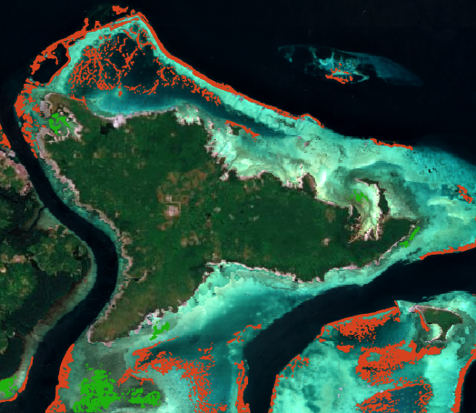
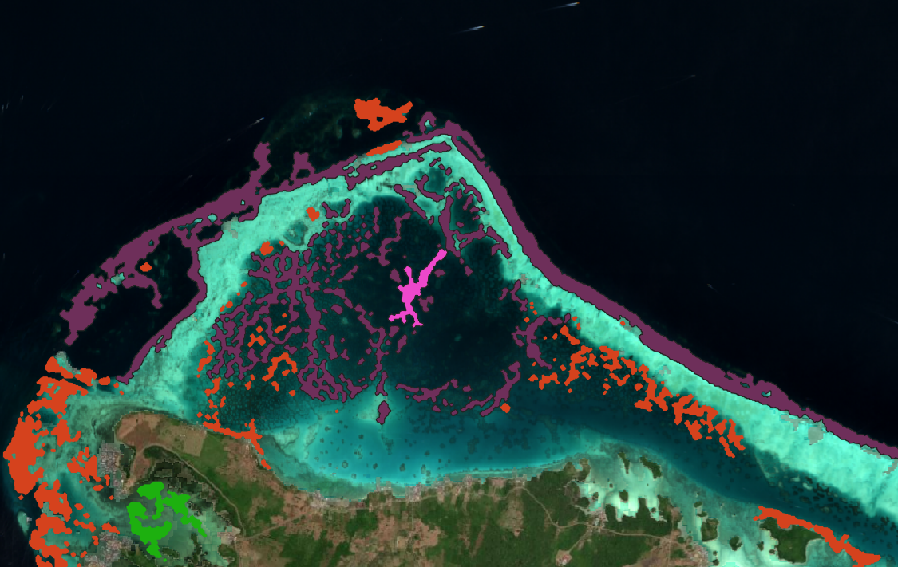

# Habitat Connectivity: Key Considerations

The habitat connectivity product turns the binary coral and SAV maps from the [Habitat Extent](../SAV/key-considerations.md) product into vector habitat patches. For each patch it gives the patch's area and lists the other patches lying within a set distance. It is a quick screening indicator of how fragmented or clustered habitat is, not an ecological connectivity model.

## Key runtime parameters

Connectivity runs automatically at the end of the Habitat Extent workflow, so its main input is the habitat extent result itself. All parameters below have default values.

| Parameter | Default | Notes |
| --- | --- | --- |
| `neighbor_threshold` | 1000 m | Maximum distance between two patch edges for them to count as neighbours. Increase it for species or processes that spread over longer distances. |
| `buffer_distance` | 10 m | Smoothing distance applied to the patch outlines. Higher values give smoother patches and remove thin parts. |
| Minimum patch size | 1000 pixels (10 ha) | Fixed in the code. Patches smaller than this in the binary map are removed before vectorization. |

The SAV probability threshold and the other [Habitat Extent](../SAV/key-considerations.md) parameters also strongly affect the results, since they decide which pixels count as habitat in the first place.

## Interpreting the outputs

One GeoJSON file is produced per habitat type, next to the binary maps in `predictions/aggr_results`:

- `<date>_aggregated_sav.tif.geojson`
- `<date>_aggregated_coral.tif.geojson`

Each feature is one habitat patch, with these attributes:

- `patch_id`: patch number, starting at 1;
- `area_ha`: patch area in hectares;
- `neighbors`: list of neighbouring patches within `neighbor_threshold`;
- `neigh_area_ha`: total area of these neighbouring patches, in hectares, not counting the patch itself.

> **Note:** The values in `neighbors` refer to the feature `id`, which starts at 0. They are therefore equal to `patch_id - 1`.

An example of the obtained result is shown in the figure below in which coral patches appear in orange, and SAV patches in green.

Patches with many neighbours and a high `neigh_area_ha` belong to dense habitat clusters. Isolated patches with few or no neighbours are more vulnerable, since they are less likely to be resupplied from nearby habitat. Colouring the patches by `neigh_area_ha` or by the number of neighbours is a quick way to see this. It is also possible to view each patch's neighbors. For example, in the following figure, the selected coral patch is displayed in pink, and all its neighbours are shown in deep purple.

Coral and SAV are processed separately, so connectivity is only computed between patches of the same habitat type.

## Limitations

- **Depends on the habitat classification.** Connectivity is computed directly from the habitat extent maps, so any missed habitat, false detection, or coral and SAV confusion carries straight into the patches and their neighbours.
- **Area is underestimated.** The 10 ha minimum patch size removes small and potentially wrong patches, but also removes real small patches. Combined with the habitat extent already being a minimum, total patch area should be read as a lower bound. Isolated small patches are the most likely to disappear, so the habitat can appear less fragmented than it is.
- **Simple distance based connectivity.** Neighbours are found using only the straight-line distance between patch edges. Land is not taken into account, so two patches on either side of a headland can be neighbours. This does not match the ecological definition of connectivity, which models the actual exchanges between patches (larvae, propagules, nutrients) using marine currents, larval duration, depth and other parameters.
- **One distance for all.** A single `neighbor_threshold` is used for all patches and both habitat types, while relevant dispersal distances vary strongly between species.
- **Edge effects.** Patches near the border of the area of interest may have neighbours outside it, which are not counted.
