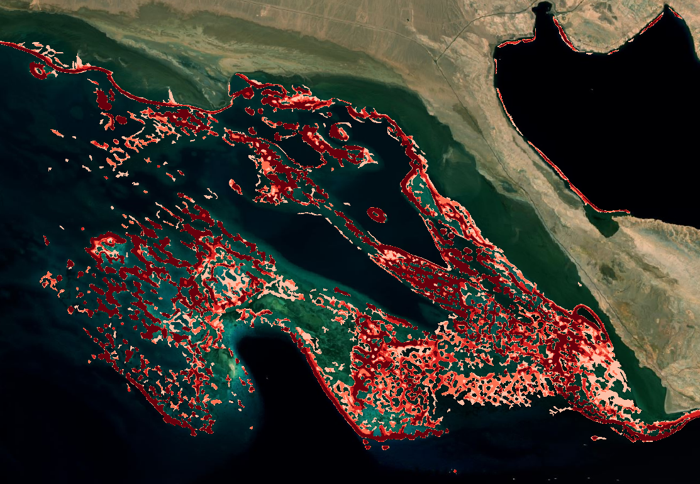
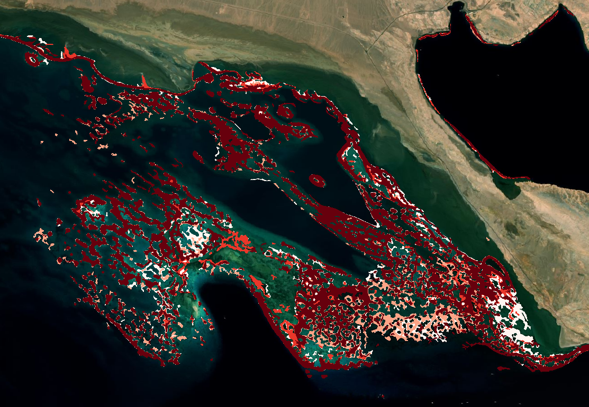
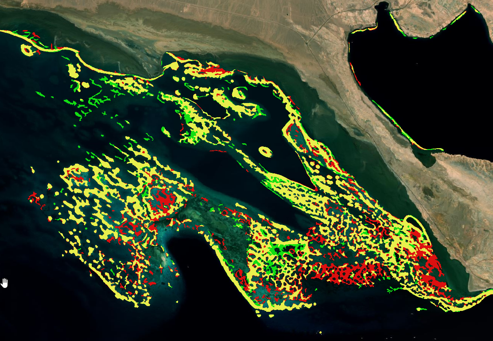

# Habitat Time Series: Key Considerations

The habitat time series product summarises several yearly habitat extent maps into per-pixel statistics. It is meant to highlight **stable habitat, losses and gains** over time, and to point to areas worth checking in more detail.

The tool is designed to compare **different years over the exact same area of interest**. Results are only comparable if every year is computed over **the same season**. Seagrass and algae grow and die back seasonally, and water clarity, cloud cover and sun glint also vary through the year. Comparing a summer result with a winter one will show changes that are only seasonal.

## Key runtime parameters

### Consistency of the yearly inputs

The most important choices are made when producing the yearly habitat extent results. For every year, keep the following identical:

- `Spatial extent`: the exact same area of interest.
- `Time period`: the same season, only the year changes.
- `Model`: the same bioregion model.
- `Maximum cloud cover`, `SWIR threshold` and `SAV probability threshold`: the same values. A change in threshold changes the mapped extent, and would appear as habitat change.

### Time series parameters

If the yearly maps do not share the same grid, they are automatically reprojected on the grid of the first year using nearest-neighbour resampling. Running every year with the same spatial extent avoids this step.

## Interpreting the outputs

All examples provided here have been evaluated on an area of interest in the red sea, from 2020 to 2026.

### Frequency

The percentage of years in which habitat was detected in each pixel. High values show a stable habitat core, while low values show habitat detected only occasionally, which can be real short-lived habitat or classification noise. In the example below, low to high frequencies range from white, to light red, to deep red.

### Last year detected

The last year in which habitat was detected in each pixel. Pixels whose last year is older than the most recent year have not been detected since, and are candidates for habitat loss. In the example below, the deeper the red, the most recent is the last detected coral habitat.

### Tendency

The change between the first and the last year of the series:

- `1`: habitat appeared (absent in the first year, present in the last), shown in green in the example below;
- `-1`: habitat disappeared (present in the first year, absent in the last), shown in red in the example below;
- `0`: habitat present in both years, and shown in yellow in the example below.

Tendency only uses the first and the last year, so it is best read together with the frequency map. A loss in a pixel with high frequency is more likely to be real than a loss in a pixel detected only once.

## Limitations

- **Depends on the yearly classifications.** All errors of the Habitat extent product carry into the time series. Since mapped extent is a minimum, a pixel not detected in a given year is not proof that habitat was absent.
- **Confusion between Coral and SAV.** The habitat extent product can confuse COral and SAV, which might appear as different tendencies if the classification alternates between the two habitat types.
- **Masked areas count as absence.** The yearly binary maps do not separate masked pixels from pixels without habitat. A cloud-covered or turbid area in one year appears as missing habitat for that year.
- **First and last year drive the tendency.** A single poor-quality first or last year can produce widespread false gains or losses. Check the yearly maps before interpreting the tendency.
