# Habitat Extent: Key Considerations

The habitat extent product shows **where submerged aquatic vegetation (SAV) and coral are likely to be present** in shallow coastal water. What the map shows as habitat is usually right. The map does not find all habitat, so treat mapped extent as a **minimum** and do not read an unmapped area as "no habitat". The product is designed for large-area screening and prioritization, for example deciding where to send a survey team, not for precise area accounting.
This page will explain the key considerations to keep in mind when using the aquatic monitoring products to find sub-aquatic vegetation (SAV) and coral patches:

- Which models and parameters to use;
- How to select relevant imagery;
- How to interpret the results;
- The limitations of the model.

## Key runtime parameters

### Necessary inputs

- `Model`:
Two different models have been trained, corresponding to two different ecological regions. The first step is to select the appropriate model, while keeping in mind their limitations:

  - A first model, trained in Malaysian coastal waters, is valid all year long, and detects corals as well as subaquatic vegetation.

  - A second model trained on the coastlines of Prince Edward Island, in Canada, which has only been trained on summer imagery (running from June to September), and only detects subaquatic vegetation.

In the portal, the model is selected when choosing the region of interest.

- `Spatial extent`
  
  - Area of interest, drawn as a polygon on the platform. Areas larger than a sentinel 2 tile (roughly 10.000 square km) might cause data download issues. When using the python code, it is defined as a four coordinates (West, South, East, North), in latitude and longitude values.

- `Time period`

  - Defines the time window for scene selection. The selection of the time frame is critical, and it is recommended to preview the Sentinel 2 imagery on a platform such as [the Copernicus Browser](!https://browser.dataspace.copernicus.eu/) to inspect the available scenes. The algorithm requires as much as possible clear atmospheric and water conditions to perform well, as mist, turbid or turbulent water, sun glint, and cloud shadows all make the classification more difficult.

### Optional parameters

The following parameters are optional and have default values, but might be important to change for different areas of interest.

- `Maximum cloud cover percentage`
  - Selects cloud-free or low-cloud Sentinel-2 observations. Only Sentinel 2 images with a lower cloud coverage are downloaded. By default, this percentage is set to 40%.

- `SWIR band threshold`
  - Threshold applied on the SWIR band (B11). Only pixels with values below this threshold are kept for the model to predict. This operation removes land, cloud-contaminated pixels, sun glint, turbid water and sensor artifacts. The lower this threshold, the harsher conditions are on the pixel quality. By default, its value is set to 250.

- `SAV probability threshold`
  - The model's main output are class probabilities, for water, corals and SAV. Only pixels with predicted SAV probability higher than this threshold are considered to contain SAV. This threshold allows increased control on the predicted SAV patches, by allowing a more conservative prediction by increasing this threshold, or by detecting more potential SAV patches by lowering it. The probabilities are multiplied by 10.000 and range between 0 and 10.000. The default threshold is set at 5000.

### Parameter reference

This section summarizes the suggested configurable parameters available to users when running the Habitat Extent product.

| Parameter | Used for | Notes |
| --- | --- | --- |
| `Bioregion model` | Classification model | Two available models, one trained in Malaysia, and the other in Canada. |
| `Spatial extent` | Defines the area of interest | Required input as a polygon drawn in the GUI or as polygon bounds in latitude and longitude. |
| `Time period` | Defines the temporal scope | Year or seasonal window. |
| `Maximum cloud cover` | Maximum cloud cover percentage on queried Sentinel 2 images | Ranges from 0 (no cloud at all) to 100 (completely covered). It is by default set at 40. |
| `SWIR threshold` | Threshold to apply on the SWIR band | Recommended range from 250 to 1000. |
| `SAV probability threshold` | Probability threshold for SAV to be detected, multiplied by 10.000 | Defaults at 5000. Recommended range from 4000 to 6500. |

## User guidelines

### Selecting the imagery

Submerged habitats are detected by the classifier on each image selected, therefore the the mapping's quality depends strongly on the imagery's quality. The main points to keep in mind while selecting the imagery to obtain the best possible results are:

- Select imagery with a low cloud cover. While clouds are masked out from the image while processing it, cloud shadows are extremely difficult to remove over open water, and can cause false SAV detections. This point is directly linked to the adjustable `Maximum cloud cover percentage` parameter.

- Select periods with stable water clarity, with both low turbidity and sediment content. These effects are often seasonal.

- Imagery containing haze, which causes light atmospheric attenuation, is typically not removed well by cloud filters and should also be avoided.

- The model trained over Canada was only trained on imagery obtained from July to September, and only imagery within this time window (or under close conditions) should be selected for prediction.

The image below shows three examples of the same area around Semporna in Eastern Malaysia, first under clear conditions ideal for SAV and coral detection, another one with haze, and a last one with high water turbidity. An excellent way to preview optical imagery to select an appropriate time window for the aquatic algorithms is to preview Sentinel 2 images on the [the Copernicus Browser](!https://browser.dataspace.copernicus.eu/).

| Clear | Hazy | Turbid |
| :---: | :---: | :---: |
| 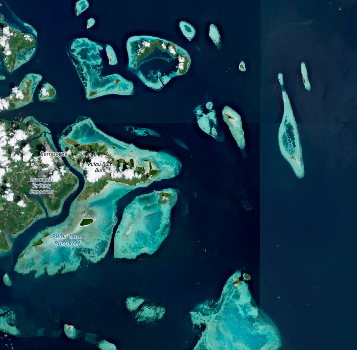 | 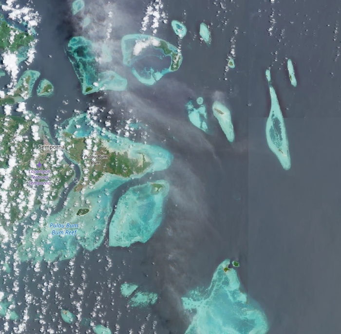 | 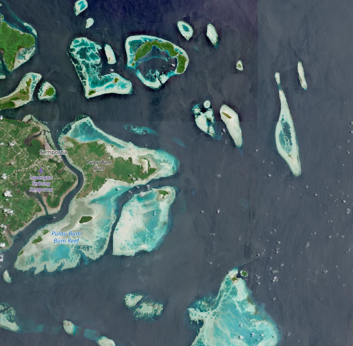 |

### Bio-regions and first use cases

Model performance is highest where ecological and optical conditions resemble those represented in training. In contrast, the model will not give reliable results over areas with different ecological conditions on which it has not been trained, for example on coastlines of an ocean for a model trained in a bay or a lagoon, like the Canadian model.

Two models have been trained, one in tropical waters in Malaysia, and the other in Canada, around the shores of Prince Edward Island, on summer imagery. The worked examples over these training areas is shown in the images below. In the prediction probability output images, red indicates a high confidence coral presence, green a high confidence SAV presence, blue a high confidence water presence, and black low confidence and masked out areas.

| Image type | Malaysian area | Prince Edward Island |
| :---: | :---: | :---: |
| Sentinel 2 optical mosaic| 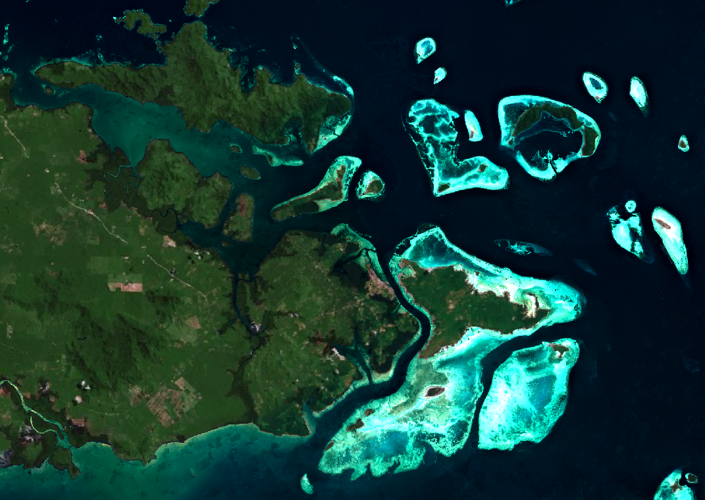 | 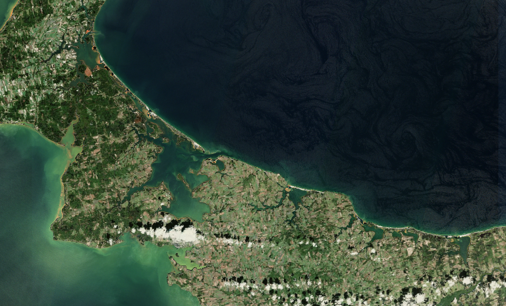 |
| Prediction probability outputs| 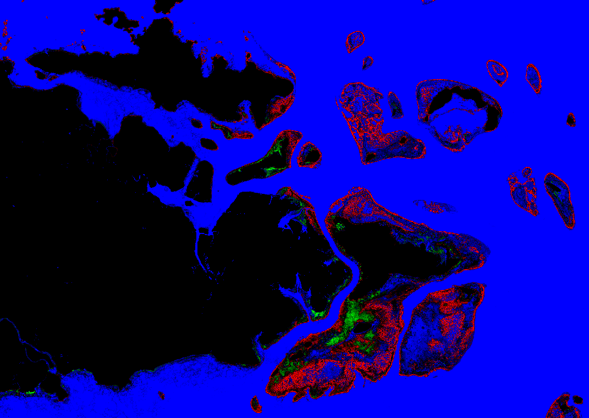 | 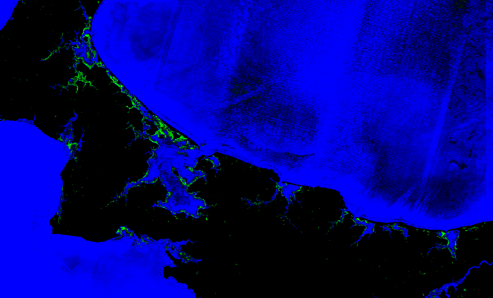 |

## Model and prediction

### Model and features

All trained models are based on Random Forest classifiers, with different sets of hyper-parameters, selected based on a geographical cross-validation. The models require the same set of features extracted from Sentinel 2 imagery. For the classification itself, the bands B02, B03, B04 and B08 from Sentinel 2 imagery (respectively corresponding to the blue, green, red and near infrared bands) were retained. Several spectral indices are computed from these bands, based on normalized difference indices and direct ratios between all combinations of two bands. Finally, we computed local statistics for all input bands and spectral indices:

- Local mean using gaussian smoothing

- Spatial statistics comparing each pixel to its surroundings

- Structural (texture) features derived using multi-scale feature extraction

This approach allows for a pixel-wise classification, while giving the model access to some spatial information. Instead of simply running a classification on the imagery, the workflow is set up to return probability values for each class, giving users more information and control over the end results.

### Post-processing

Additionally, two post-processing steps are applied to the model classification for files containing masks for habitat presence. These two steps are:

- A probability threshold over the different prediction classes. For SAV, this threshold can be adapted in the parameters.

- A sieve filtering algorithm which removes isolated pixels and improves spatial coherence of the predicted habitats.

## Interpreting the outputs

The Habitat extent product automatically downloads all eligible Sentinel-2 images over the selected area of interest and during the time window from Openeo. It then creates a pixel-wise habitat probability map for each image. Finally, aggregated results are obtained by averaging model prediction on each scene in the selected time-series. Results are saved in a folder called `predictions`

The aggregated results are the product's main results, as they are more robust to the noise introduced by meterological conditions on single scenes. They are saved in a subfolder called `aggr_results` in `predictions`.
Additionally, all classification outputs on single images are also saved, and can be used to explore scene-based results and understand potential issues. These files are saved as a series of geo-tiff files directly in the `predictions` folder.

### Aggregated results

#### Composite image

The mean composite Sentinel-2 image is saved as a geo-tiff file, and contains in this order the Blue, Green, Red and NIR bands. The composite image is calculated on the remaining pixels after filtering, with all land areas are already filtered out. It is recommended to compare the results obtained for habitat presence and extent to this composite optical image, as it can highlight potential issues or errors. These images can sometimes contain dark patches over water, which come from unfiltered cloud shadows. This file is saved as 

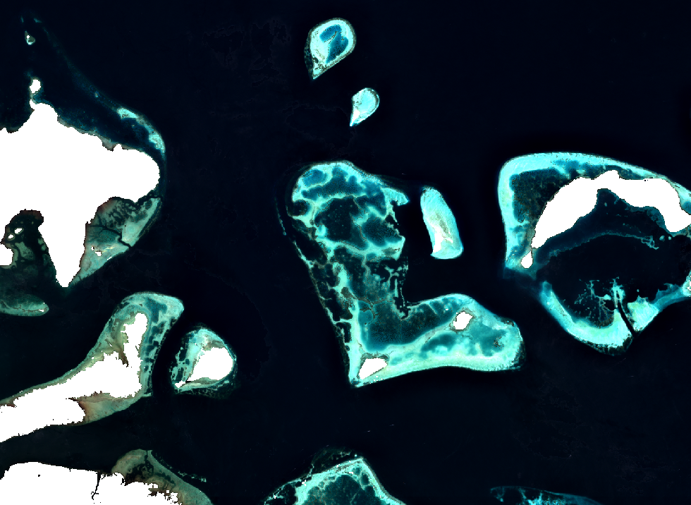

#### Habitat probability

The habitat probability is an excellent way to preview model predictions and adjust the SAV probability threshold if needed. It is a geo-tiff file containing the model's prediction probabilities for the Coral, SAV and water class probabilities in this order. The probabilities are scaled from 0 to 10.000, and it is recommended to the image by stretching each band from 4000 to 8000. This file gives the best overview of the model's inner workings and results, and together with the composite image, helps choose relevant thresholds and remove potential false detections caused by cloud shadows, or atmospheric effects.

This visualization highlights in red high coral probabilities, in green, high SAV probabilities, and in blue, high open water probabilities. Pixels appearing in dark show areas where the model certainties are lower and no class is predicted with certainty, or masked out areas. An example of this output over the same area as the composite image is shown below.

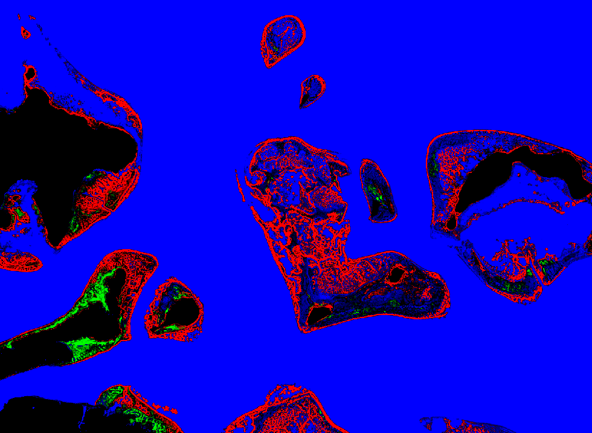

#### Classification

A classification output based on each pixel's maximum probability class is also saved as a geo-tiff file, with a single band. The values in the file are:

- 0: Masked out data;
- 1: Coral;
- 2: SAV;
- 3: Water.

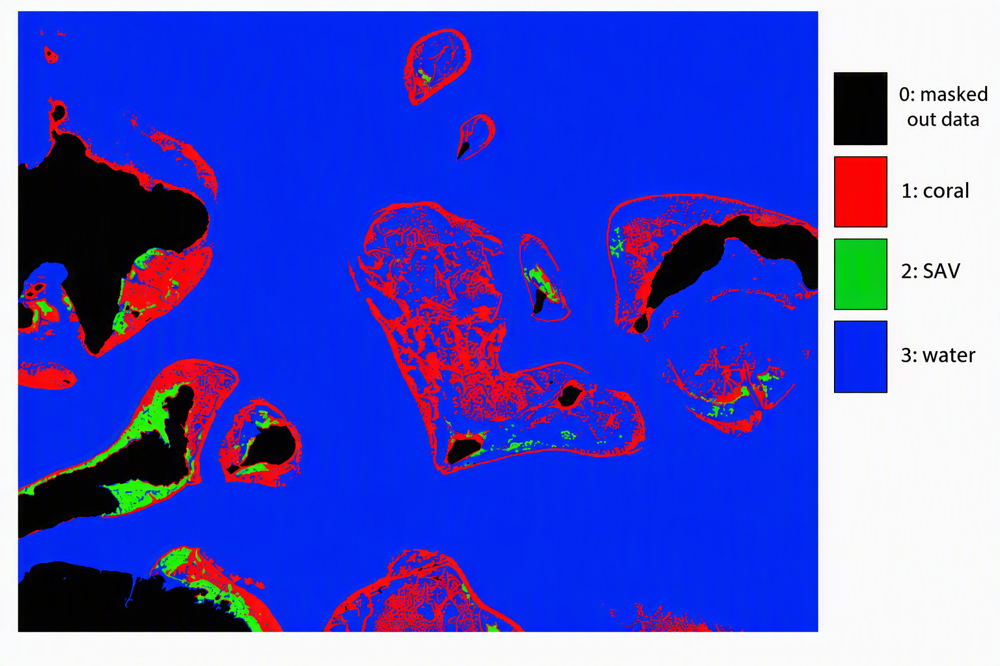

#### Probability maps

Additionally, the model probability outputs on all pixels are saved for Coral and SAV separately, in two geo-tiff files containing a single band. These bands are directly extracted from `sav_aggr_probs.tif`. The probabilities in the files are also scaled by a factor 10.000. Examples for Coral and SAV probability maps are displayed in the figure below.

| Coral probability | SAV probability |
| :---: | :---: |
| 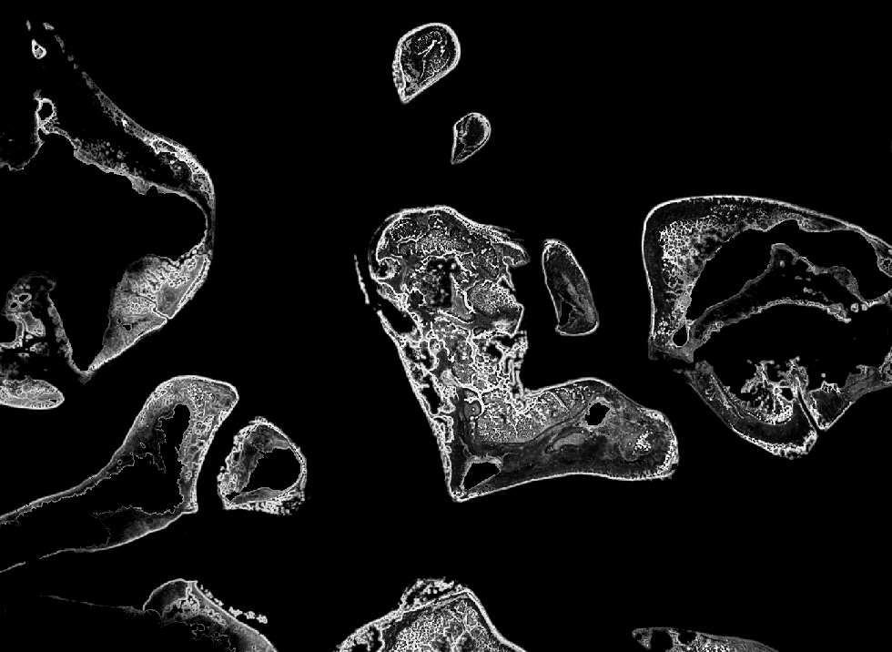 | 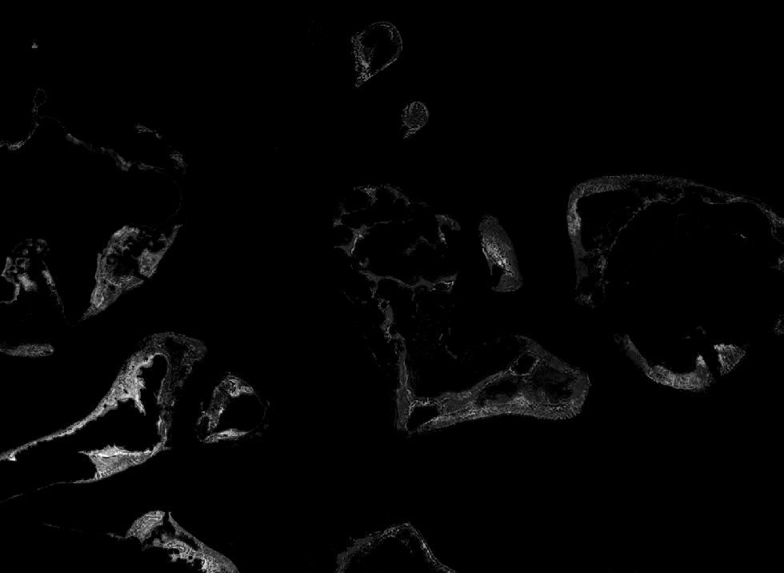 |

#### Binary maps

Finally, the outputs which are directly used for the habitat connectivity and time-series are the binary maps containing the detected Coral and SAV habitats at a pixel level on the time-series. Two geo-tiff files, one for coral presence, and one for SAV presence are created, with a single binary band. These maps are created using the selected probability threshold and applying a sieve filter.

### Per scene results

Despite the filtering steps, challenging imagery with large shadows or rough water can still influence the habitat prediction capabilities. Specific images with bad conditions can influence the end result with false habitat detections, or no detection where habitats actually are. If the results observed in the aggregated probability tif file seem unsatisfactory, similar three bands probability tif files are saved for each individual Sentinel 2 scene used for prediction. These files follow the same architecture as the habitat probability file, with three bands, ranging from 0 to 10.000, giving the model class probability for Coral, SAV and water for each scene. These files can be used to find potential bad imagery causing wrong detections.

### Summary

1. Preview the available Sentinel-2 images [the Copernicus Browser](!https://browser.dataspace.copernicus.eu/) and confirm that your time window contains at least a few images with clear water and no cloud shadow over your area.
2. Use the model of the bioregion you are working in (tropical model for Southeast Asian reef systems, sub-polar model for sheltered North Atlantic bays in summer). Do not apply a model outside its bioregion without local checks.
3. Only interpret results in water shallower than about 6 to 7 m. Deeper detection is possible in very clear water but is not reliable.
4. Look at the per-scene results. If one image produces obviously wrong habitat (for example along cloud edges or in turbid plumes), remove it and rerun.
5. Before reporting a habitat type (coral versus SAV), confirm a sample of locations with field data, drone imagery or local knowledge.
6. Report the area as a minimum ("at least X ha"), together with the time window, model, thresholds and number of images used.

## Limitations

- **Mapped extent is a minimum.** Validation shows the true extent is about 1.8 (sub-polar SAV) to 2.3 (tropical coral and SAV) times the mapped extent. Unmapped areas cannot be read as habitat absence.
- **Depth.** Reliable mapping reaches about 6 to 7 m depth. In clear water the signal can reach 10 to 15 m, but not dependably, and turbidity or plankton can reduce this to a few metres.
- **Observation availability.** Clouds, cloud shadow, sun glint and turbidity remove most images over many coasts. Results depend on how many clear images exist in your time window, and this varies between years and seasons.
- **Coral and SAV confusion.** In the tropics the two are often confused. The detection of benthic habitat is more reliable than the habitat label.
- **Bioregion transfer.** The models perform best where conditions resemble the training areas. A test in the Gulf of Suez showed SAV accuracy dropping to 36 %, so new regions need local checks or retraining.
- **Not for trends on its own.** Differences between years can reflect differences in image quality rather than real habitat change.
- **Higher accuracy needs local fine-tuning.** Where precise maps are needed, tailored site-specific mapping with local reference data is the better route. In Semporna, adding a small number of local annotations raised coral accuracy from 52 % to 81 %.
